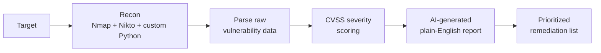

<!-- ===================== HEADER ===================== -->
<div align="center">


<a href="https://github.com/abhilashkardev">
  
</a>

<br/>


</div>

---

## 👨‍💻 About Me

```text
┌────────────────────────────────────────────────────────────────┐
│  NAME       : Abhilash Kar                                     │
│  ROLE       : Cybersecurity Intern @ UPTOSKILLS                │
│  STUDYING   : B.Tech CSE (2024 - 2028)                         │
│  COLLEGE    : Seemanta Engineering College                     │
│  FOCUS      : Ethical Hacking, Pentesting, Infra Security      │
│  LOCATION   : Baripada, Odisha, India 🇮🇳                       │
│  LANGUAGES  : Odia · Bengali · Hindi · English                 │
│  MOTTO      : "Learn it. Break it. Fix it. Share it."          │
└────────────────────────────────────────────────────────────────┘
```

I'm a B.Tech CSE student and cybersecurity intern with hands-on experience in **ethical hacking, penetration testing and secure infrastructure deployment**. I work with Burp Suite, Metasploit, Nmap and Wireshark, and I've built and deployed real security tools: an AI-powered vulnerability scanner, a cloud-hardened WireGuard VPN, and my own DNS and hosting infrastructure.

- 🔐 Currently doing network and web vulnerability assessments as a **Cybersecurity Intern at UPTOSKILLS**
- 🚔 Delivered **cyber crime awareness** sessions with **Odisha Police**
- 🧪 Ethical hacking and credential auditing in authorized lab environments at **Vaultofcodes**
- 🏅 Certified through **Google, IBM, Deloitte (Forage), Skillup and Uptoskills**
- 📝 I document every finding with risk ratings, proof of concept and remediation steps
- 🌱 Always learning, always breaking (legally!) and always fixing

---

## 💼 Experience

| Role | Organization | Period | What I do |
|---|---|---|---|
| 🛡️ **Cybersecurity Intern** | UPTOSKILLS (Remote) | 27 May 2026 – Present | Network and web vulnerability assessments with Nmap, Burp Suite and Hydra; manual web pentesting for auth flaws, access-control issues and OWASP risks; leading a team and writing structured pentest reports |
| 🚔 **Cybersecurity & Cyber Crime Awareness** | Odisha Police (On site) | 24 Jun – 31 Jul 2026 | Awareness sessions and workshops on phishing, social engineering, MFA, password security and safe browsing; led a team and demonstrated common attack techniques |
| 🕵️ **Ethical Hacking** | Vaultofcodes (Remote) | 25 Jun – 25 Aug 2026 | Authorized lab pentesting; password auditing with John the Ripper and Hydra; led a team, documented findings and remediation |

---

## 🏆 Best Project

<div align="center">

### 🤖 AI-Based Vulnerability Scanner


</div>

Security scanners dump walls of raw output that business owners and non-technical stakeholders can't act on. This project closes that gap: it scans a target, scores what it finds, and explains the results in **plain English with clear remediation steps**.



**Highlights**
- 🔎 Automated reconnaissance pipeline for asset discovery and vulnerability mapping
- 📊 CVSS-based severity scoring so critical findings are fixed first
- 🗣️ Reports written for non-technical readers, with actionable fixes
- ⚡ Faster remediation workflow from scan to fix

👉 **[View the repository](https://github.com/abhilashkardev/REPO-NAME)**

---

## 🚀 Featured Projects

| Project | Description | Tech |
|---|---|---|
| 🤖 [**AI-Based Vulnerability Scanner**](https://github.com/abhilashkardev/REPO-NAME) | Parses raw vulnerability data and writes plain-English remediation reports for non-technical stakeholders. Automated recon pipeline with CVSS-based severity scoring | `Python` `Nmap` `Nikto` `CVSS` |
| 🔒 [**WireGuard VPN Server on Azure**](https://github.com/abhilashkardev/REPO-NAME) | Production-grade VPN on an Azure Ubuntu VM with automated key generation, peer management, hardened iptables rules, custom DNS, split-tunneling, health checks and failover monitoring | `WireGuard` `Azure` `iptables` `Bash` |
| 🌐 [**Personal Server Infrastructure & Custom DNS**](https://github.com/abhilashkardev/REPO-NAME) | Nginx reverse proxy with SSL termination for multiple subdomains, authoritative ns1/ns2 DNS servers, automated Let's Encrypt renewal, patching and log analysis via cron (99%+ uptime) | `Nginx` `DNS` `Let's Encrypt` `Linux` |
| 📱 **Smart Security Social Media System for SMEs** | Real-time monitoring across social platforms to detect phishing, impersonation and spam targeting small businesses. ML anomaly detection, instant email/SMS alerts and a remediation dashboard | `Python` `Scikit-learn` `Flask` `OAuth 2.0` `REST APIs` |

---

## 🔧 Ongoing Projects

| Project | What I'm building | Status |
|---|---|---|
| 🧅 **P2P File Transfer over Tor** | Anonymous peer-to-peer file sharing using Tor onion services, with no central server and no exposed IPs |  |
| 🎣 **Targeted Threat Defense** | Detecting threats aimed at specific individuals: sandboxing incoming email for HR and sales teams, plus server honeypots that use deception to catch attackers |  |
| 🧪 **Custom Vulnerable Lab ISO** | A purpose-built vulnerable machine image for hands-on cybersecurity training and attack-chain practice |  |

---

## 🗺️ Planned Projects

| Project | Idea | Status |
|---|---|---|
| 🛰️ **Home SOC Lab with SIEM** | Deploy Wazuh or the ELK stack to collect logs from my lab machines, write detection rules and practise incident response |  |
| 🎭 **Phishing Awareness Simulator** | A safe, self-hosted tool for running phishing-awareness exercises, building on my cyber crime awareness work with Odisha Police |  |
| 🧰 **Automated Recon Framework** | Combine Nmap, Gobuster and Nikto into one scripted workflow that outputs a structured pentest report |  |
| 📝 **CTF & Lab Write-up Blog** | Publish write-ups of the labs and attack chains I complete, with remediation notes |  |

---

## 🛠️ Tech Stack & Tools

**Languages & Frameworks**


**Security Tools**


**Infrastructure & Platforms**


**Core Skills:** Ethical Hacking · Network Security · Vulnerability Assessment · Penetration Testing · VPN Architecture · SSH Hardening · Log Analysis · TCP/IP · DNS Management · Firewall Configuration (iptables/ufw) · SSL/TLS · Cron Automation · Technical Documentation

---


---

## 🎖️ Beyond Code

- 🇮🇳 **National Service Scheme (NSS)**: active member for 6 years
- 🌅 **Up Young India, Vivekananda Kendra Kanyakumari**: active member for 6 years
- 🏆 **District-Level Quiz** (Republic Day & Independence Day): 2-time winner
- 📚 **Mayurbhanj Book Fair Quiz Competition**: 2-time winner
- 🕵️ **Quiz Competition by the Vigilance Department**: winner

---

## 📊 GitHub Stats

<div align="center">


<br/>


<br/>


</div>

---

## 🌐 Connect With Me

<div align="center">

<a href="https://github.com/abhilashkardev"></a>
<a href="https://linkedin.com/in/abhilashkar"></a>
<a href="https://instagram.com/abhilash_.kar"></a>
<a href="https://youtube.com/@informationstrength"></a>

<a href="mailto:abhilashkar.dev@gmail.com"></a>
<a href="https://abhilashkardev.github.io/qr"></a>

<a href="https://twitter.com/YOUR-X-USERNAME"></a>
<a href="https://discord.com/users/YOUR-DISCORD-ID"></a>
<a href="https://t.me/YOUR-TELEGRAM-USERNAME"></a>

<a href="https://www.hackthebox.com/home/users/profile/YOUR-HTB-ID"></a>
<a href="https://tryhackme.com/p/YOUR-THM-USERNAME"></a>

</div>

---

## 💬 Let's Collaborate

I'm open to:

- 🤝 Cybersecurity projects, CTF teams and bug bounty collaboration
- 🎓 Internships and entry-level security roles
- 🧪 Lab building, pentest documentation and awareness programs
- 📚 Study groups and knowledge sharing

> 📫 **Best way to reach me:** a LinkedIn message or email (links above).

---

## ⚠️ Disclaimer

All security work on this profile is for **educational purposes** and is performed only on systems I own or have explicit permission to test. Please use any knowledge shared here responsibly and legally.

---

<div align="center">

### ⭐ If you like my work, consider giving a star to my repositories!


</div>
